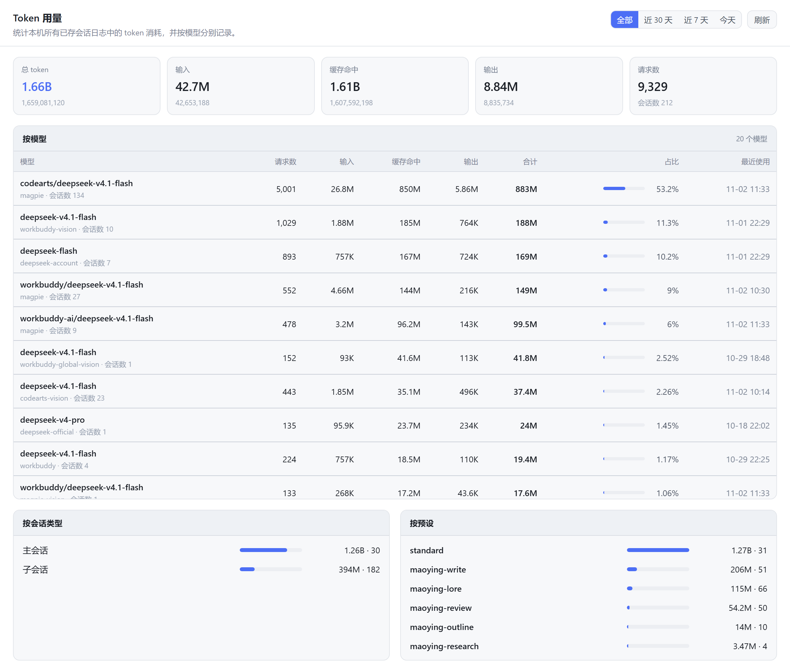

# dsh-token-usage

**A token-usage panel for DeepSeek Harness** — totals the token spend of *every stored session* on your machine, broken down **per model**.

[中文](README.md) · [Share copy](docs/share.md) · [Changelog](CHANGELOG.md) · [MIT](LICENSE)

  

Once installed, a **Token usage** entry appears in the sidebar panel list. Open it and you get a full page of statistics:

- **How much was spent in total**: total / input / cache read / output / requests / sessions
- **Which model spent it**: requests, input, cache read, output, total, share bar and last-used time for every `provider + model`
- **Where it went**: main sessions vs subagent sessions, per agent preset, and a per-provider breakdown
- **When it was spent**: all / last 30 days / last 7 days / today, plus recent-days and recent-sessions rankings

Everything is **offline**: the data comes from local session logs only. No network requests, nothing reported anywhere.

<!-- Rendered by `node scripts/make-screenshot.mjs`: real panel component, shipping CSS, real usage data -->



## Contents

- [Features](#features)
- [What the page shows](#what-the-page-shows)
- [Install](#install)
- [How tokens are counted](#how-tokens-are-counted)
- [How it works](#how-it-works)
- [HTTP API](#http-api)
- [FAQ](#faq)
- [Development and self-checks](#development-and-self-checks)
- [License](#license)

## Features

| | |
| --- | --- |
| Data source | Read-only access to `~/.dsh/sessions/**/session.v4.jsonl.zstd`; nothing is written, no session data is modified, no other plugin's DOM is touched |
| Trustworthy numbers | Same definition as Harness' built-in `tokenUsage` projection, so the panel matches the usage pill inside an individual session |
| Model grouping | `message.source.provider` + `message.source.model` are authoritative; a duplicated `provider/` prefix is stripped (only when it is actually compatible with the provider), so one model never splits into two rows |
| Incremental scan | Each session's `revision` is checked: unchanged sessions reuse their previous ledger, changed ones only read the tail after the last `seq`. First full scan of 220+ sessions / 8700+ usage events takes ~1–2 s; every later request is a cache hit |
| Time windows | The scan buckets by **local calendar day** (`YYYY-MM-DD`) right away, so switching between today / 7 days / 30 days only merges those buckets — no disk access |
| Theme and language | Only `--dsw-alias-*` design tokens, so it follows the light/dark theme automatically; Chinese and English UI |
| Dependencies | **Zero runtime dependencies** (`react` comes from the Harness frontend; no Harness Client package is required) |
| Clean uninstall | The route and both slots are registered through `ctx.effect`, so disabling the plugin removes them automatically |

## What the page shows

| Block | Contents |
| --- | --- |
| Summary cards | total (large value + exact value), input, cache read, output, requests (with session count as a hint) |
| By model | model (provider + name) / requests / input / cache read / output / total / share bar / last used, sorted by total |
| By session type | main sessions vs subagent sessions (`origin: subagent`) |
| By preset | usage, session count and model count per agent preset (`standard`, `maoying-write`, …); bars are scaled to the largest preset |
| By provider | total and share per provider |
| Recent days | per-day totals (local calendar day), up to 30 days |
| Recent sessions | title, type, preset, total, updated time; 8 rows by default, "expand" shows all |
| Footer | counting note (input excludes cache read/write) + scan time / session count |

## Install

DeepSeek Harness (desktop app or `dsh web`) is required. This package is a standard bundle: `dsh.bundle.patch` points at `cordis.patch.yml`, which inserts a `@local/dsh-token-usage` row.

### Option 1 — plugin manager (recommended)

In the Harness plugin manager, choose "install bundle / local directory" and point it at the **absolute path** of this package, then restart Harness.

### Option 2 — manual install into a profile

```bash
# replace <profile> with yours (desktop uses "desktop"; the CLI usually uses "default")
cd ~/.dsh/profiles/<profile>

# back up package.json / pnpm-lock.yaml first
pnpm link /absolute/path/to/dsh-token-usage   # adds the dependency + creates the node_modules symlink
```

Then append `"@local/dsh-token-usage"` to the `dsh.profile.bundles` array in that `package.json` and restart Harness.

> **Desktop note**: `dsh plugin --profile desktop ...` is rejected outright (`profile "desktop" is managed exclusively by the Electron application`). The CLI only works for your own profiles, so on the desktop app use the two manual steps above, or the plugin manager.

### Option 3 — straight from GitHub (git dependency)

`dsh plugin` simply forwards its arguments to pnpm inside the profile directory, so a git dependency works too:

```bash
cd ~/.dsh/profiles/<profile>
pnpm add github:fuchen9/dsh-token-usage
# and still append "@local/dsh-token-usage" to dsh.profile.bundles
```

### After installing

- **Changing `lib/index.js` (the host half) requires a Harness restart**: the host half is loaded at startup and hot reload does not cover it.
- **Changing only `lib/client.js` (the UI) does not**: client bundles are versioned and have an HMR channel, so a page refresh (use `Ctrl+Shift+R` if needed) picks up the new build.

## How tokens are counted

- **Total** = `inputTokens + cacheReadTokens + cacheWriteTokens + outputTokens`, compared against the event's own `totalTokens`, and the **larger** of the two wins (some adapters report only three fields, or omit the cache fields).
- **Input / cache read / cache write / output** are accumulated separately and are never double-counted into the total.
- **Requests** = number of `assistant/message` events that carry `usage`; **sessions** = sessions with at least one usage event.
- Cache reads usually dominate (every turn of a multi-turn conversation re-sends the context), so the "input" card is much smaller than the total. That is expected.
- The `usage` in those events is what the **model actually reported**, not an estimate, and it is the very same source Harness uses for a single session's usage pill.

## How it works

```
~/.dsh/sessions/<workspace>/<sessionId>/session.v4.jsonl.zstd
        │  zstd JSONL: first line is the session header, then one event per line
        ▼
Host half  lib/index.js
   ctx.sessionPersistence.list()                        enumerate every stored session
   ctx.sessionPersistence.open(id,'read').read(cursor)  incremental read only
   ctx.sessions.list()                                  live sessions via snapshotEvents()
        │  only events with type === "assistant/message" that carry usage
        ▼
   one ledger per session: lifetime fold (fast path for "all") + per-day, per-model buckets
        │  buckets merged per range → memoized view
        ▼
   GET /api/dsh-token-usage?range=all|30d|7d|today
        ▼
Client half  lib/client.js
   sidebar.panellist icon entry (order 35)
   main keyed page (key = token-usage)
```

A few implementation notes worth keeping:

- **`inject` declarations are not optional.** The host half uses `export const inject = ["webServer", "sessionPersistence", "sessions"]`. Cordis' `ctx` is a Proxy, so **reading an undeclared service throws**, and `?.` only guards `null`/`undefined` — it does not catch a thrown error. Miss one service name and the whole scan is silently swallowed by the surrounding try/catch, which shows up as "all the numbers are 0".
- **Time windows are bucketed by day.** A single scan stores "day → per-model counters", so switching ranges is just a Map merge in memory and never touches the disk; results are memoized per range and invalidated by any new scan.
- **The flex guard on the scroll column** (`.dstu_body>*{flex:0 0 auto}`) must stay. A flex item whose `overflow` is not `visible` gets an automatic minimum size of 0, so `overflow:hidden` cards shrink to a few pixels and an `overflow:auto` table shrinks to nothing — the page then looks like "the lower half vanished and it will not scroll". The guard pins every child at its natural height.
- **The route only trusts local same-origin requests**: `Host` must be loopback or the bound address, a present `Origin` must match `Host`, `sec-fetch-site: cross-site` is rejected, and anything other than GET/HEAD returns 405.

## HTTP API

```http
GET /api/dsh-token-usage?range=all|30d|7d|today&refresh=1
```

`refresh=1` forces a rescan (throttled to 1.5 s); otherwise the cache is used. Response:

```jsonc
// example for shape; totals are measured values, and the extra
// "total - (input+cacheRead+output)" comes from events carrying a larger totalTokens
{
  "ok": true,
  "range": "all",
  "generatedAt": 1793580906429,
  "scanMs": 68,
  "totals": { "requests": 8722, "input": 37231505, "output": 8728315,
              "cacheRead": 1383406617, "cacheWrite": 0, "reasoning": 0,
              "total": 1431113686, "sessions": 207, "models": 17, "truncatedSessions": 0 },
  "models":   [ { "provider": "magpie", "model": "codearts/deepseek-v4.1-flash",
                  "requests": 8396, "input": 36100000, "output": 8400000,
                  "cacheRead": 1350000000, "cacheWrite": 0, "reasoning": 0,
                  "total": 1397000000, "sessions": 180,
                  "first": 1793442677781, "last": 1793580906429, "share": 0.6093 } ],
  "providers": [ /* same shape, aggregated per provider */ ],
  "agents":    [ { "kind": "user", "models": 12, "sessions": 29, "total": 997276076 } ],
  "presets":   [ { "preset": "standard", "models": 9, "sessions": 30, "total": 999395644 } ],
  "daily":     [ { "day": "2026-11-02", "tokens": 30708966 } ],
  "sessions":  [ { "id": "session-…", "label": "default-workspace", "kind": "user",
                   "preset": "standard", "requests": 462, "tokens": 49611623,
                   "start": 1793541154094, "end": 1793580906429 } ]
}
```

Every array is capped (models ≤200, providers ≤50, agents/presets ≤30, daily ≤30, sessions ≤60) so a large ledger cannot blow up the response.

## FAQ

**"Last 30 days" shows exactly the same numbers as "All".**
If your machine has less than 30 days of usage history, the 30-day window covers everything and the two are **necessarily equal**. That is not a bug. Use "today" or "last 7 days" to confirm the window is really applied.

**The panel says it cannot read the index / every number is 0.**
The host half's scan failed. The most common cause is a missing service name in `export const inject` (see above). Check the Harness log for `dsh-token-usage: scan failed: …` — the panel also prints the raw error when the payload has one.

**The lower half of the page is invisible and it will not scroll.**
A flex child of the scroll column got squeezed; the `.dstu_body>*{flex:0 0 auto}` guard exists precisely to prevent that, and `node scripts/harness-layout.mjs` verifies it.

**Does it report my usage anywhere?**
No. The plugin makes no outbound requests at all: the only network traffic is Harness itself talking to your models, and this plugin merely reads those session logs.

## Development and self-checks

No running Harness needed. All four scripts are **assertion based** (they throw and exit non-zero on failure, so no eyeballing numbers):

```bash
node scripts/check-helpers.mjs     # pure functions: counting, model-name normalisation, time windows, origin checks (31 assertions)
node scripts/harness-host.mjs      # runs the host half against real session logs + a real HTTP route (four ranges, 403/405/HEAD)
node scripts/harness-dom.mjs       # renders the page in jsdom and asserts the numbers and labels, incl. that a range switch really shrinks them
node scripts/harness-layout.mjs    # measures the real CSS in headless Edge: every block keeps its height and the column scrolls
```

- `harness-host.mjs` uses a **Proxy** as its fake ctx which throws `cannot get property "<name>" without inject` exactly like Cordis, so a missing service name reproduces locally. It also recomputes the expected per-range values from the raw logs to cross-check the plugin's output.
- `harness-dom.mjs` needs jsdom/react/react-dom, installed into `.verify/node_modules` (never into the package):

  ```bash
  npm install --prefix .verify --no-save --no-package-lock jsdom react react-dom
  ```

- `harness-layout.mjs` injects the package's **real CSS** into the framework's real ancestor chain, measures it, then strips the guard rule and reruns — the stripped run **must** reproduce the old "card squashed to 0" bug, otherwise the check is not testing anything. It needs a Chromium/Edge binary; set `EDGE_PATH` to point at one.

A GitHub Actions workflow (`.github/workflows/checks.yml`) runs `check-helpers.mjs` and `harness-dom.mjs` on Node 22 and 24; `harness-host.mjs` needs real session logs and `harness-layout.mjs` needs a browser, so those two stay local.

Additionally, `node scripts/scan-panel-css.mjs <package> …` extracts layout-related CSS rules from compiled Harness client bundles, so you can compare against how official plugins do it.

`scripts/` and `.verify/` are development-only and are not part of the published package (`files` does not list them).

## License

[MIT](LICENSE)