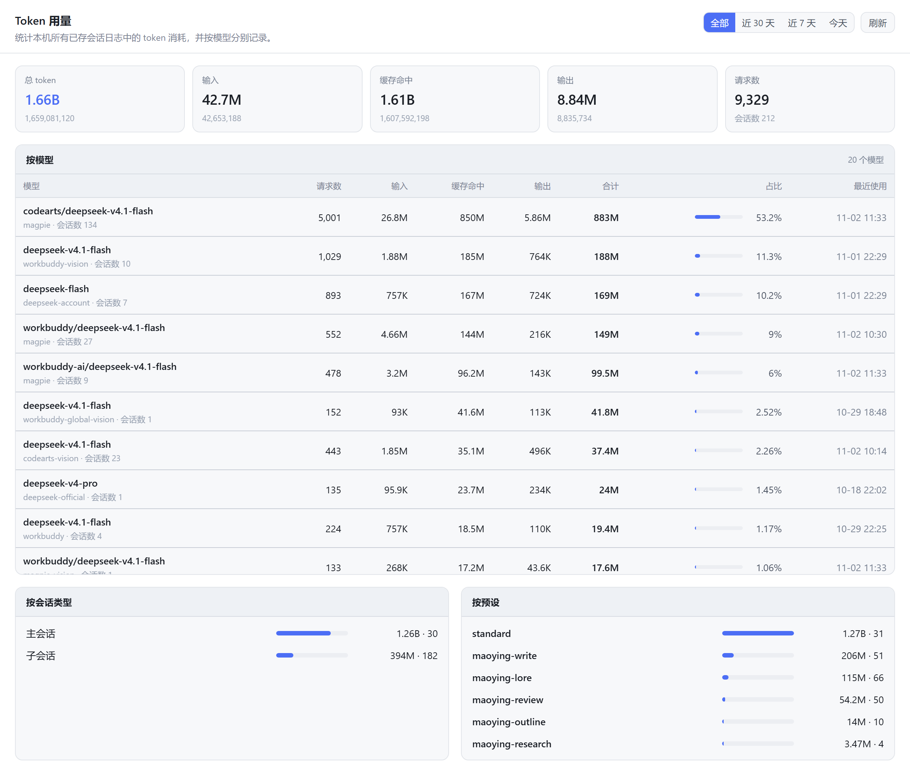

# dsh-token-usage

**DeepSeek Harness 的 Token 用量统计插件** —— 汇总本机**全部已存会话**的 token 消耗，并按**模型**分别记录。

[English](README.en.md) · [分享文案](docs/share.md) · [更新日志](CHANGELOG.md) · [MIT](LICENSE)

  

装好后侧边栏面板列表里会多出一个「Token 用量」入口，点开是一整页统计：

- **一共烧了多少**：合计 / 输入 / 缓存命中 / 输出 / 请求数 / 会话数
- **哪个模型占了多少**：每个 `提供商 + 模型` 的请求数、输入、缓存命中、输出、合计、占比条、最近使用时间
- **花在哪里**：按会话类型（主会话 / 子会话）、按预设（agent preset）、按提供商对照
- **什么时候花的**：全部 / 近 30 天 / 近 7 天 / 今天一键切换；最近几天、最近会话排行

全部**离线**完成：数据只来自本机的会话日志，不发任何网络请求，也不上报到任何地方。

<!-- 截图由 `node scripts/make-screenshot.mjs` 生成：真实面板组件 + 出货样式 + 真实用量数据 -->



## 目录

- [特性](#特性)
- [页面内容](#页面内容)
- [安装](#安装)
- [统计口径](#统计口径)
- [它是怎么做到的](#它是怎么做到的)
- [HTTP API](#http-api)
- [常见问题](#常见问题)
- [开发与自检](#开发与自检)
- [许可](#许可)

## 特性

| | |
| --- | --- |
| 数据来源 | 只读 `~/.dsh/sessions/**/session.v4.jsonl.zstd`，不落盘、不改动任何会话数据，也不读别的插件的 DOM |
| 口径可信 | 与 Harness 自带的 `tokenUsage` 投影同口径，面板数字和单个会话里的用量气泡对得上 |
| 模型分组 | 以 `message.source.provider` + `message.source.model` 为权威；模型名里重复的 `provider/` 前缀会自动剥掉（且只在真的和 provider 相容时才剥），同一模型不会裂成两行 |
| 增量扫描 | 按会话 `revision` 判断是否变化，没变就复用旧账、变了只读 `seq` 之后的尾巴。实测 220+ 会话、8700+ 条用量事件首次全量约 1–2 秒，之后每次请求都是缓存命中 |
| 时间窗口 | 扫描时即按**本地日历日**分桶（`YYYY-MM-DD`），切「今天 / 近 7 天 / 近 30 天」只在这些桶上合并，不重读磁盘 |
| 主题与语言 | 只用 `--dsw-alias-*` 设计 token，自动跟随明暗主题；中文 / English 双语 |
| 依赖 | 运行时**零第三方依赖**（`react` 由 Harness 前端自带，不额外 require 任何 Harness Client 包） |
| 卸载干净 | 路由与两个槽位都走 `ctx.effect`，禁用插件后自动撤销 |

## 页面内容

| 区块 | 内容 |
| --- | --- |
| 汇总卡片 | 合计（大字 + 精确值）、输入、缓存命中、输出、请求数（副标题带会话数） |
| 按模型 | 模型（提供商 + 模型名）/ 请求数 / 输入 / 缓存命中 / 输出 / 合计 / 占比条 / 最近使用，按合计降序 |
| 按会话类型 | 主会话 vs 子会话（`origin: subagent`）的用量与数量对比 |
| 按预设 | 每个 agent preset（`standard` / `maoying-write` …）的用量、会话数与模型数，条长按最大项归一 |
| 按提供商 | 各 provider 的合计与占比 |
| 最近几天 | 按天（本地日历日）的合计，最多显示 30 天 |
| 最近会话 | 会话标题、类型、预设、合计、更新时间；默认 8 条，「展开」看全部 |
| 页脚 | 口径提示（输入不含缓存读取/写入）+ 扫描耗时 / 会话数 |

## 安装

需要 DeepSeek Harness（桌面版或 `dsh web`）。本包就是一个标准 bundle：`package.json` 的 `dsh.bundle.patch` 指向 `cordis.patch.yml`，其中插入一行 `@local/dsh-token-usage`。

### 方式一：插件管理器（推荐）

在 Harness 的插件管理器里选择「安装 bundle / 本地目录」，指向这个包的**绝对路径**，然后重启 Harness。

### 方式二：手工装进某个 profile

```bash
# <profile> 换成你的 profile 名（桌面版是 desktop，CLI 通常是 default）
cd ~/.dsh/profiles/<profile>

# 备份 package.json / pnpm-lock.yaml
pnpm link /绝对路径/dsh-token-usage          # 写入依赖 + 建 node_modules 软链接
```

然后把 `"@local/dsh-token-usage"` 追加到该 `package.json` 的 `dsh.profile.bundles` 数组里，重启 Harness。

> **桌面版注意**：`dsh plugin --profile desktop ...` 会被直接拒绝（`profile "desktop" is managed exclusively by the Electron application`），CLI 只对自建 profile 有效；桌面版请用上面两步手工做，或直接走插件管理器。

### 方式三：直接从 GitHub 装（git 依赖）

`dsh plugin` 本质是把参数转发给 profile 目录里的 pnpm，所以 git 依赖也能装：

```bash
cd ~/.dsh/profiles/<profile>
pnpm add github:fuchen9/dsh-token-usage
# 同样别忘把 "@local/dsh-token-usage" 加进 dsh.profile.bundles
```

### 装完之后

- **改 `lib/index.js`（Host 半）必须重启 Harness**：Host 半只在启动时加载，热重载不覆盖它。
- **只改 `lib/client.js`（界面）不用重启**：客户端 bundle 有版本号 + HMR 通道，刷新页面（必要时 `Ctrl+Shift+R`）就会拿到新版本。

## 统计口径

- **总 token** = `inputTokens + cacheReadTokens + cacheWriteTokens + outputTokens`，并与事件自带的 `totalTokens` 取**较大者**（个别适配器只报三个字段，或不含缓存字段）。
- **输入 / 缓存命中 / 缓存写入 / 输出** 分别累加，互不重复计入总和。
- **请求数** = 带 `usage` 的 `assistant/message` 事件条数；**会话数** = 至少有一条用量事件的会话数。
- 缓存读取通常占绝对多数（多轮对话里每轮都要重放上下文），所以「输入」这一栏会远小于「合计」，这是正常的。
- 事件里的 `usage` 是**模型真正回报的用量**，不是估算值；这与 Harness 单会话的用量气泡完全同源。

## 它是怎么做到的

```
~/.dsh/sessions/<workspace>/<sessionId>/session.v4.jsonl.zstd
        │  逐行 zstd JSONL：首行是会话头，其后每行一个事件
        ▼
Host 半  lib/index.js
   ctx.sessionPersistence.list()  枚举所有已存会话
   ctx.sessionPersistence.open(id,'read').read(fromCursor)  只读增量
   ctx.sessions.list()            进程内活跃会话走 snapshotEvents()
        │  只吃 type === "assistant/message" 且带 usage 的事件
        ▼
   每个会话一份账：生命周期折叠（全量快路径） + 按天的 per-model 桶
        │  按 range 合并桶 → 记忆化视图
        ▼
   GET /api/dsh-token-usage?range=all|30d|7d|today
        ▼
Client 半  lib/client.js
   sidebar.panellist 图标入口（order 35）
   main 键控页面（key = token-usage）
```

几个值得记下来的实现要点：

- **`inject` 声明不是可选的**：Host 半用 `export const inject = ["webServer", "sessionPersistence", "sessions"]`。Cordis 的 `ctx` 是 Proxy，**没在 `inject` 里声明的服务一读就抛错**，而 `?.` 只挡 `null`/`undefined`、挡不住抛出的异常 —— 少写一个服务名会让整轮扫描被 try/catch 静默吞掉，面板上表现为「数字全是 0」。
- **时间窗口按天分桶**：一次扫描就把「某天 → 每模型计数」存下来，切 range 只是内存里的 Map 合并，因此来回切不碰磁盘；`?range=` 的结果按 range 记忆化，任何一次新扫描都会让缓存失效。
- **滚动列的 flex 守卫**：`.dstu_body>*{flex:0 0 auto}` 必须留着。flex 子项的 `overflow` 只要不是 `visible`，浏览器就把它的自动最小尺寸当作 0 —— 于是 `overflow:hidden` 的卡片会被压成几像素、`overflow:auto` 的表格被压成 0，页面看起来就是「下半截不见了，还滚不动」。这条守卫把每个子项钉在自然高度上。
- **路由只信本机同源请求**：`Host` 必须是 loopback 或绑定地址，带了 `Origin` 就必须和 `Host` 一致，`sec-fetch-site: cross-site` 直接拒绝，非 GET/HEAD 返回 405。

## HTTP API

```http
GET /api/dsh-token-usage?range=all|30d|7d|today&refresh=1
```

`refresh=1` 强制重扫（有 1.5 秒节流），否则命中缓存。返回：

```jsonc
// 结构说明用的示例；totals 为实测值，多出的 "total - (input+cacheRead+output)"
// 是那些自带更大 totalTokens 的事件（见「统计口径」）
{
  "ok": true,
  "range": "all",
  "generatedAt": 1793580906429,
  "scanMs": 68,
  "totals": { "requests": 8722, "input": 37231505, "output": 8728315,
              "cacheRead": 1383406617, "cacheWrite": 0, "reasoning": 0,
              "total": 1431113686, "sessions": 207, "models": 17, "truncatedSessions": 0 },
  "models":   [ { "provider": "magpie", "model": "codearts/deepseek-v4.1-flash",
                  "requests": 8396, "input": 36100000, "output": 8400000,
                  "cacheRead": 1350000000, "cacheWrite": 0, "reasoning": 0,
                  "total": 1397000000, "sessions": 180,
                  "first": 1793442677781, "last": 1793580906429, "share": 0.6093 } ],
  "providers": [ /* 同结构，按 provider 聚合 */ ],
  "agents":    [ { "kind": "user", "models": 12, "sessions": 29, "total": 997276076 } ],
  "presets":   [ { "preset": "standard", "models": 9, "sessions": 30, "total": 999395644 } ],
  "daily":     [ { "day": "2026-11-02", "tokens": 30708966 } ],
  "sessions":  [ { "id": "session-…", "label": "default-workspace", "kind": "user",
                   "preset": "standard", "requests": 462, "tokens": 49611623,
                   "start": 1793541154094, "end": 1793580906429 } ]
}
```

数组都有上限（models ≤200、providers ≤50、agents/presets ≤30、daily ≤30、sessions ≤60），避免在超大用量下把响应撑爆。

## 常见问题

**「近 30 天」和「全部」的数字一模一样？**
如果本机有用量记录的历史不足 30 天，30 天窗口会覆盖全部数据，两者**必然相等**，这不是 bug。要确认窗口真的在生效，用「今天」或「近 7 天」对照。

**面板显示「无法读取用量索引」/ 数字全是 0？**
Host 半扫描失败。最常见的原因是 `export const inject` 里漏了服务名（见上文实现要点）；先看 Harness 日志里的 `dsh-token-usage: scan failed: …`，面板在有 `error` 时也会把原始错误直接显示出来。

**页面下半截看不到、也滚不动？**
滚动列的 flex 子项被压扁了，`.dstu_body>*{flex:0 0 auto}` 这条守卫就是为了挡它；`node scripts/harness-layout.mjs` 会专门验证这件事。

**会不会把用量上报出去？**
不会。插件没有任何出站请求：唯一的网络行为是 Harness 自己拿着会话日志去调用模型，而本插件只是读那些日志。

## 开发与自检

不用起 Harness 也能验证，四个脚本都是**断言式**的（不通过就抛错、非零退出，不需要人眼看数字）：

```bash
node scripts/check-helpers.mjs     # 纯函数：口径、模型名归一、时间窗口、来源校验（31 项断言）
node scripts/harness-host.mjs      # 穿真实会话日志跑一遍 Host 半 + 真 HTTP 路由（四个 range、403/405/HEAD）
node scripts/harness-dom.mjs       # jsdom 里真渲染页面，断言关键数字与文案、切 range 后数字真的变小
node scripts/harness-layout.mjs    # 无头 Edge 里量真实 CSS：每个区块保住高度、滚动列真的能滚
```

- `harness-host.mjs` 的假 ctx 是 **Proxy**，会像真 Cordis 一样对未声明服务抛 `cannot get property "<name>" without inject` —— 这样本地就能复现「少写一个服务名」的故障；它还拿真实日志自己算一遍 per-range 期望值，交叉校验插件输出。
- `harness-dom.mjs` 需要 jsdom/react/react-dom，装在 `.verify/node_modules`（不进包）：

  ```bash
  npm install --prefix .verify --no-save --no-package-lock jsdom react react-dom
  ```

- `harness-layout.mjs` 会把包里的**真实 CSS** 塞进框架真实的祖先链里量尺寸，然后把守卫规则删掉重跑一遍 —— 要求**必须复现**「卡片被压成 0」的老 bug，否则说明这个检查没在测东西。它需要一个 Chromium/Edge 可执行文件，可用 `EDGE_PATH` 指定。

仓库里还带了一个 GitHub Actions workflow（`.github/workflows/checks.yml`），在 Node 22 / 24 上跑 `check-helpers.mjs` 与 `harness-dom.mjs`；`harness-host.mjs` 需要真实的会话日志、`harness-layout.mjs` 需要浏览器，所以这两个只在本地跑。

另外 `node scripts/scan-panel-css.mjs <包名> …` 可以从已编译的 Harness 客户端 bundle 里抽出布局相关的 CSS 规则，用来对照官方插件的写法。

`scripts/`、`.verify/` 只用于开发自检，不随包发布（`files` 白名单不含它们）。

## 许可

[MIT](LICENSE)